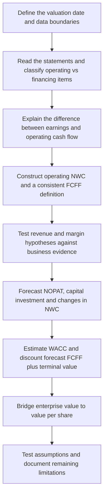

# WD-40: Modeling Process and Assumption Development

**Companion to the [valuation report](README.md), [reverse DCF comparison](REVERSE_DCF.md) and [editable Excel model](WD40_DCF_Portfolio.xlsx)**  
**Historical valuation date:** 27 October 2025  
**Prepared:** 26 October 2026  
**Units:** USD millions unless stated otherwise

This document explains how financial-statement observations became forecast assumptions and valuation inputs. It preserves the consequential calculations, revised hypotheses and unresolved judgments. The final financial tables, valuation and sensitivity grids are in the report and workbook.

## 1. The analytical workflow



The objective was to understand and complete a manual DCF before automating its components. The project therefore prioritizes material business judgments, consistent definitions and an auditable calculation chain. A regression-based WACC module remains a future extension.

The main decision sequence was:

| Question | Analytical action | Result carried into the model |
| --- | --- | --- |
| Does higher net income mean stronger cash generation? | Reconcile net income to CFO and isolate unusual tax effects. | Forecast normalized operating profit rather than extrapolating reported earnings. |
| Which liabilities belong in the equity bridge? | Separate financing debt from operating payables and accruals. | Operating liabilities affect NWC; financing debt is deducted from EV. |
| Should divestitures determine the entire growth path? | Measure the affected businesses against group sales. | Use core maintenance growth as the main driver. |
| How much operating leverage is credible? | Separate initial investment from recurring and step-fixed costs. | Gradual EBIT-margin improvement to 18.0%. |
| Does low PP&E spending capture all capital investment? | Match cloud amortization with a separate investment allowance. | 0.8% PP&E plus 0.4% other capitalized investment. |
| Which uncertainties deserve further work? | Test operating drivers and discount-rate assumptions. | Prioritize terminal economics, WACC and operating margins. |

## 2. Establish the information boundary

The financial starting point is the FY2025 10-K, which contains FY2023–FY2025 income and cash-flow statements and FY2024–FY2025 balance sheets. FY2025 ends on 31 August 2025. The filing was accepted on 27 October 2025 at 16:12:49, after the regular market close. [S1], [S2]

The distinction between an information date and the period described matters. The company's **FY2026 guidance**, published on **22 October 2025**, was available at the historical valuation date. FY2026 actual results published later were not. [S5]

This study was built retrospectively in 2026. During the research process, later FY2026 results and a later change in the Americas divestiture plan were seen before the final revenue-growth assumptions were settled. They are not numerical model inputs, but their prior availability creates potential hindsight bias. The record supports an explanation of the model's reasoning; it does not establish a forecast genuinely frozen in 2025.

Cash and debt use August 2025 balances as proxies, while the rounded share count comes from 21 October 2025. The 27 October regular-session close is a historical comparison price that predates that day's 10-K filing. These dates remain explicit throughout the valuation. [S1], [S2]

## 3. Classify items before calculating ratios

### Liquidity, financing debt and operating NWC answer different questions

An early calculation used selected current assets divided by short-term borrowings. That omitted receivables and other current assets from the numerator, and operating liabilities from the denominator. The complete current ratio is:

```math
Current\ ratio = \frac{Total\ current\ assets}{Total\ current\ liabilities}
```

| Calculation | FY2024 | FY2025 |
| --- | ---: | ---: |
| Total current assets | 255.441 | 284.956 |
| Total current liabilities | 103.500 | 102.257 |
| Current ratio | 2.47× | 2.79× |

The corrected result indicates improved balance-sheet liquidity coverage. It does not imply the extraordinary improvement suggested by comparing only selected assets with bank borrowings. [S1]

For the enterprise-to-equity bridge, the relevant category is financing debt. FY2025 book net debt is:

```math
Book\ net\ debt = 0.800 + 86.195 - 58.130 = 28.865
```

Accounts payable and operating accruals are not added to that debt total: they already affect forecast working capital. The valuation later uses a **market-value debt estimate**, producing a different net-debt figure:

```math
Market\ net\ debt = 82.200 - 58.130 = 24.070
```

The book measure describes reported leverage; the market estimate is the adopted valuation bridge. [S1]

A useful sign check is to hold everything else constant and increase accounts payable by \$10m. Operating NWC falls by \$10m and current-period FCFF rises by \$10m. Deducting the same payable again as financing debt would double count it. This is a timing benefit from supplier credit, not a permanent source of free cash.

**Model consequence:** classify each item by economic function before using its accounting label in a formula.

## 4. Explain why profit and cash flow diverged

FY2025 net income increased from **69.644 to 90.994**, while CFO declined from **92.034 to 87.925**. The first hypothesis to test was whether reported profit growth represented recurring operating cash generation. [S1]

### Step 1: isolate the unusual tax item

FY2025 net income includes an **11.929 favorable tax release**. The cash-flow reconciliation subtracts this noncash benefit. Its negative adjustment removes an accounting gain; it does not itself demonstrate deteriorating operations. [S1]

The forecast uses a **23.9% normalized tax assumption**, approximately the FY2024 effective rate, instead of extending FY2025's roughly 10.5% reported rate indefinitely. This is a modeling choice, not a prediction of each future year's cash tax payments.

### Step 2: build the complete CFO bridge

```math
CFO_{2024} = 69.644 + 17.765 + 4.625 = 92.034
```

```math
CFO_{2025} = 90.994 + 7.438 - 10.507 = 87.925
```

The year-on-year change therefore reconciles as:

```math
\Delta CFO = 21.350 - 10.327 - 15.132 = -4.109
```

The increase in earnings was outweighed by lower noncash adjustments and weaker operating asset/liability cash adjustments. Inventory and other-asset outflows warrant investigation, but their presence alone does not establish weak demand or permanently impaired economics. Changes may reflect inventory policy, growth investment, payment timing or noncash effects. [S1]

### Step 3: calculate a cash-generation measure without calling it FCFF

```math
CFO\ less\ PP\&E_{2024} = 92.034 - 4.206 = 87.828
```

```math
CFO\ less\ PP\&E_{2025} = 87.925 - 4.528 = 83.397
```

That measure fell by about **5.0%**. It is useful for historical analysis, but it retains reported CFO's tax, financing and noncash-adjustment conventions. It is not the EBIT-based unlevered cash flow forecast used below.

**Model consequence:** investigate the cause of a cash-flow change before interpreting it as a change in franchise quality.

## 5. Build operating NWC from the footnotes

The first operating-capital approximation was:

```math
ONWC_{core}=Receivables+Inventory-Payables
```

This gives **160.621 in FY2024** and **162.505 in FY2025**, an increase of **1.884**. It is easy to understand but excludes payroll, operating accruals and other current assets.

The general accounting measure, current assets less current liabilities, is also unsuitable without adjustment: it includes cash and financing debt. Its FY2025 increase of **30.758** answers a different question from the cash investment in operating NWC. [S1]

The expanded estimate classifies the additional items:

| USD millions | FY2024 | FY2025 | Treatment |
| --- | ---: | ---: | --- |
| Receivables | 117.493 | 120.589 | Include. |
| Inventory | 79.088 | 79.871 | Include. |
| Other current assets | 12.161 | 26.366 | Start with the disclosed balance. |
| Less: held-for-sale assets | 0.000 | (7.290) | Exclude from the ongoing operating estimate. |
| Less: estimated income-tax receivables | (0.500) | (4.900) | Exclude; disclosed amounts are approximate. |
| Adjusted other current assets | 11.661 | 14.176 | Include the remaining estimated operating balance. |
| Accounts payable | (35.960) | (37.955) | Deduct as an operating liability. |
| Accrued liabilities | 31.272 | 34.230 | Adjust before deducting. |
| Less: current operating lease liabilities | (2.294) | (2.282) | Exclude from the accrual balance used in this NWC estimate. |
| Adjusted accrued liabilities | (28.978) | (31.948) | Deduct. |
| Accrued payroll | (26.055) | (28.415) | Deduct. |

The table contains intermediate subtotals and is not intended to be summed vertically. The final calculations are:

```math
ONWC_{2024}=117.493+79.088+11.661-35.960-28.978-26.055=117.249
```

```math
ONWC_{2025}=120.589+79.871+14.176-37.955-31.948-28.415=116.318
```

```math
\Delta ONWC_{2025}=116.318-117.249=-0.931
```

These are analyst estimates constructed from reported balances and approximate tax details. The **0.931 balance decrease is not a separately verified cash release**. FX, reclassifications and other noncash effects prevent a simple balance-sheet difference from necessarily matching the cash-flow statement. Operating leases remain in operating expenses; their liabilities are not also deducted as financing debt. [S1]

**Model consequence:** retain **116.318** as the FY2026 opening balance and apply the forecast sales ratio prospectively.

## 6. Revise the revenue hypothesis after measuring divestiture scale

The initial working hypothesis was that divestitures would create a low-growth transition, followed by recovery. An illustrative growth path of **2%, 4%, 6%, 6%, 6%** reflected that idea.

The next step was to check what was being sold and how much revenue it represented. FY2025 disclosures showed:

| Business | FY2025 revenue | Share of group revenue | Status at the historical information date |
| --- | ---: | ---: | --- |
| Core maintenance products | 590.966 | 95.3% | Main continuing franchise. |
| UK cleaning brands | 6.216 | 1.0% | Sale completed in August 2025. |
| Americas cleaning brands | 13.765 | 2.2% | Sale planned, not completed. |
| Asia-Pacific cleaning brands | 9.038 | 1.5% | Retained. |

*Percentages are independently rounded. [S1]*

The key judgment changed after quantifying scale: a relatively small, potentially one-off reduction in the sales base did not provide a strong reason to impose a prolonged slowdown on the much larger core business. A completed sale, an intended sale and a retained business also require different treatment.

The adopted path became **5.0% in FY2026 and 5.5% in FY2027–FY2030**:

```math
Revenue_{2026}=619.985(1.05)=650.984250
```

```math
Revenue_{2027}=650.984250(1.055)=686.788384
```

The same recurrence produces FY2030 revenue of **806.455336**. The path is an analyst scenario for consolidated revenue. It does not separately subtract divested sales, and it differs from management's divestiture-adjusted pro forma guidance. [S5]

**Model consequence:** make core growth the main revenue driver, retain divestiture uncertainty as a limitation, and test growth through sensitivity analysis. The research chronology in Section 2 limits any claim that this judgment was formed without hindsight.

## 7. Derive the margin path from cost behavior

Between FY2023 and FY2025, gross margin increased from about **51.04% to 55.06%**, but EBIT margin remained near **16.7%**. Higher operating expenses absorbed much of the gross-margin improvement. A better product mix therefore does not automatically establish a higher operating margin. [S1]

The central judgment was to separate the cost categories:

| Cost category | Reasoning used in the forecast |
| --- | --- |
| Existing staff and additional hiring | Recurring labor cost; some hiring occurs in steps. |
| Systems implementation | Initial spending may moderate, but operation and maintenance continue. |
| International expansion | Entry costs may be spread over a larger sales base; compliance, translation, legal and marketing costs remain. |
| Advertising and promotion | Continuing commercial investment, with no assumption that it disappears. |

That reasoning supports **moderate operating leverage**: expenses can keep growing while growing more slowly than sales. It led to an FY2030 EBIT-margin assumption of **18.0%**, with a gradual path of **16.9%, 17.2%, 17.5%, 17.8%, 18.0%**.

A conditional reasonableness check holds gross margin near 55.1%:

```math
Operating\ expense\ ratio_{2030}\approx55.1\%-18.0\%=37.1\%
```

This implies a roughly 1.2 percentage-point reduction from FY2025's approximately 38.3%, without requiring operating expenses to stop growing. It is a cross-check, not a separately forecast gross-margin schedule.

The sensitivity is economically meaningful. At FY2030 revenue of 806.455336, an additional margin point adds about **8.065 of EBIT** and **6.137 of NOPAT**, holding tax constant.

**Model consequence:** use a gradual improvement justified by cost structure, then test alternative margins rather than treating management's long-term adjusted EBITDA target as an EBIT forecast.

## 8. Match D&A with the investment being deducted

FY2025 separately reports D&A of **8.191** and cloud implementation amortization of **1.688**. Combined, **9.879 / 619.985 = 1.59% of revenue**, supporting a rounded **1.6%** forecast intensity. [S1]

FY2025 PP&E purchases were **4.528**, or about **0.73% of revenue**. The outsourced production model supports relatively modest physical investment, but PP&E spending alone does not capture every capitalized operating investment. [S1]

The chosen forecast separates:

| Driver | Assumption | Interpretation |
| --- | ---: | --- |
| D&A / revenue | 1.6% | Includes cloud amortization. |
| PP&E investment / revenue | 0.8% | Normalized physical investment. |
| Other capitalized investment / revenue | 0.4% | Estimated cloud/systems allowance. |
| Combined capital investment / revenue | 1.2% | Sum of the two spending assumptions; excludes NWC investment. |

The 0.4% allowance is an estimate, not a disclosed historical cash-spending ratio. Separately modeled cloud investment is treated as excluded from forecast NWC to avoid deducting the same forecast spending twice. This separation is a forecast assumption: cloud-related amounts within historical residual other current assets have not been fully isolated.

### Historical FCFF: CFO and EBIT paths

Three historical estimates helped expose differences in tax, noncash-adjustment and operating-capital definitions. Their values should not be treated as equivalent measures or a statistical valuation range.

The CFO route begins with the common approximation:

```math
FCFF \approx CFO + I(1-T) - Capital\ investment
```

The after-tax add-back removes the effect of financing on operating cash flow. In a simplified setting with fully deductible interest, matched tax/cash timing and no nonoperating income:

```math
NI=(EBIT-I)(1-T)=EBIT(1-T)-I(1-T)
```

Adding back interest requires removing the associated tax saving too, so the net adjustment is **I − IT = I(1 − T)**. With interest of 3.441 and tax of 23.9%, the assumed shield is **0.822399** and the after-tax add-back is **2.618601**. Adding the full 3.441 would leave the financing tax benefit inside the cash flow. The standard WACC framework separately reflects that benefit through after-tax debt cost.

For FY2025, the initial CFO proxy uses **interest expense of 3.441**, not cash interest paid:

```math
87.925+3.441(1-0.239)-4.528=86.015601
```

The EBIT route normalizes operating tax directly:

```math
103.793(1-0.239)+9.879-4.528-1.884=82.453473
```

Replacing the core three-item NWC increase of 1.884 with the expanded estimate's balance decrease of 0.931 gives:

```math
103.793(1-0.239)+9.879-4.528-(-0.931)=85.268473
```

| FY2025 historical estimate | USD millions | Main convention |
| --- | ---: | --- |
| CFO + after-tax interest expense − gross PP&E purchases | **86.016** | Reported CFO, expense-based interest proxy and normalized assumed shield. |
| Normalized EBIT method, core three-item NWC | **82.453** | AR + inventory − payables. |
| Normalized EBIT method, expanded NWC | **85.268** | Expanded balance-sheet estimate from Section 5. |

The 10-K separately reports **cash interest paid of 3.522**. Mechanically substituting that figure produces **86.077242**, a 0.061641 increase. This remains a comparison proxy: actual tax-shield realization, payment timing and operating scope have not been fully reconstructed. The adopted 23.9% is a normalized assumption, not a measured cash or marginal tax rate. [S1]

The difference between the expanded EBIT estimate and the expense-based CFO proxy can be reconciled exactly:

| Accounting bridge | USD millions | Calculation |
| --- | ---: | --- |
| Start: expanded-NWC EBIT estimate | 85.268473 | As above. |
| Replace normalized NOPAT with NI + after-tax interest | 14.626128 | 90.994 + 2.618601 − 78.986473. |
| Replace D&A-only add-back with full noncash adjustments | (2.441000) | 7.438 − 9.879. |
| Replace the balance-change proxy with CFS asset/liability adjustments | (11.438000) | −10.507 − (+0.931). |
| **Expense-based CFO proxy** | **86.015601** | Sum of the bridge. |

This is an accounting identity, not proof that the economic definitions have been normalized. The first adjustment includes tax and nonoperating-income differences; it is not all a tax adjustment. Full noncash adjustments include SBC and the reversal of the unusual tax release. The final adjustment substitutes actual CFS adjustments for a balance-sheet estimate; it does not identify each underlying cash/noncash cause.

The EBIT estimates deduct PP&E purchases but include cloud amortization in D&A, without establishing a complete corresponding cloud-investment deduction. SBC is added back within reported CFO but retained as an economic cost in the forecast EBIT method. The unusual 11.929 tax benefit has already been reversed in CFO and should not be removed a second time. These are reasons to preserve the different labels rather than force the estimates to agree.

The **Historical Financials** worksheet now calculates all three estimates, the cash-interest comparison and the exact accounting bridge. Forecasts continue to use the selected NOPAT, comprehensive capital-investment and NWC conventions, instead of rolling any one historical estimate forward mechanically.

SBC provides another consistency check. It is compensation and an operating economic cost, even though CFO adds it back as a noncash item. The adopted forecast retains SBC within EBIT without a separate add-back. Future dilution is not explicitly forecast, which remains a valuation limitation.

**Model consequence:** maintain consistent add-backs and investment deductions. The gap between 1.6% D&A and 1.2% capital investment remains an unresolved terminal-sustainability question.

## 9. Assemble FY2026 FCFF and check the opening balance

With revenue of **650.984250**, the forecast proceeds as follows:

| Step | Calculation | FY2026 |
| --- | --- | ---: |
| EBIT | 650.984250 × 16.9% | 110.016338 |
| NOPAT | EBIT × (1 − 23.9%) | 83.722433 |
| Add D&A | Revenue × 1.6% | 10.415748 |
| Less capital investment | Revenue × 1.2% | (7.811811) |
| Closing operating NWC | Revenue × 18.8% | 122.385039 |
| Less increase in operating NWC | 122.385039 − 116.318000 | (6.067039) |
| **FCFF** | NOPAT + D&A − capital investment − increase in NWC | **80.259331** |

*Calculations use unrounded inputs; displayed amounts are independently rounded.*

The same forecast rules produce FCFF of **85.911, 92.290, 99.111 and 105.790** in FY2027–FY2030. Closing NWC in each year becomes the next year's opening balance.

One reconciliation exposed an important implementation choice. Applying 18.8% retroactively to FY2025 revenue gives:

```math
619.985\times18.8\%=116.557180
```

This is **0.239180 higher** than the adjusted historical estimate of 116.318. Using it as opening NWC would reduce FY2026 incremental NWC by the same amount and raise FCFF to **80.498511**. The discrepancy comes from changing the opening-balance assumption, not from an error in the FCFF arithmetic.

**Model consequence:** use the historical opening estimate and forecast only future closing balances from the sales ratio. Keep comparisons to fixed base-case controls separate from formulas that should change when assumptions change.

## 10. Build a provisional WACC without overstating its precision

The starting framework is CAPM with market-value weights:

```math
R_e=R_f+\beta ERP=4.01\%+0.85(5.00\%)=8.26\%
```

The Treasury observation belongs to 27 October 2025. Beta 0.85, ERP 5.00% and pretax debt cost 5.00% are scenario assumptions; beta was not estimated by regression. [S3]

Market equity is:

```math
E=195.38\times13.528=2,643.100640
```

The market-debt estimate is **61.200 of senior-note fair value + 20.995 of revolver borrowings = 82.195**, rounded to **82.200**. This yields approximately **96.98% equity** and **3.02% debt**. The debt balances retain their FY2025 dates. [S1], [S4]

```math
WACC=\frac{E}{E+D}(8.26\%)+\frac{D}{E+D}(5.00\%)(1-23.9\%)=8.125629\%
```

The active rounded assumption is **8.13%**. In the workbook, the component reference build explains that figure, while **Sensitivity Analysis!F6** remains the adopted editable input. Changing a reference component requires explicitly updating the adopted WACC if that change is intended to affect valuation.

**Model consequence:** complete the valuation with a transparent provisional rate, then prioritize an empirical beta estimate using returns ending at the historical valuation date. More decimal places do not improve the underlying evidence.

## 11. Discount cash flow, bridge to equity and test the conclusion

The annual base discounts the five forecast cash flows over periods **1–5**. With terminal growth of **2.5%**:

```math
TV_{2030}=\frac{105.790047(1.025)}{0.0813-0.025}\approx1,926.018
```

The displayed FCFF in this formula is rounded; the workbook uses its unrounded value.

| Valuation step | Amount |
| --- | ---: |
| PV of explicit forecast FCFF | 364.769 |
| PV of terminal value | 1,302.955 |
| Enterprise value | 1,667.724 |
| Add cash, less market debt | 58.130 − 82.200 |
| Equity value | 1,643.654 |
| Divide by shares | 13.528 |
| **Value per share** | **\$121.50** |

The historical valuation date and the annual discount convention are separate choices. A timing-only Actual/365 calculation uses **308 / 365 = 0.8438 years** to FY2026 year-end and produces **\$122.99** per share. It retains full fiscal-year FCFF and historical cash/debt proxies, so it does not represent a complete interim roll-forward.

The terminal value accounts for **78.1% of EV**, making terminal assumptions material. The sensitivity exercises answer two different questions:

| Test | Example result | Interpretation |
| --- | --- | --- |
| WACC × terminal growth | At g = 2.5%, WACC of 7.13% / 8.13% / 9.13% gives \$148.63 / \$121.50 / \$102.57. | Required returns materially affect value. |
| Revenue growth × EBIT margin | Adding 1.0 percentage point to every forecast growth rate and margin gives \$132.79. | Test a coherent operating change through the full model. |

The operating grid applies **percentage-point shifts to all five years**, not an absolute growth rate or a change only to the terminal-year margin. These are scenario results, not probabilities or predictions of future share prices.

A further step reverses the question: which individual input would make this model reproduce the reference price? With FCFF and terminal growth fixed, the solved WACC is **6.045566%**; under the unchanged CAPM component assumptions and market weights, it maps to beta **0.421050**. These are conditional price matches, not observations of investors' beliefs or estimates of beta. The [reverse DCF comparison](REVERSE_DCF.md) separates this capital-cost experiment from alternative terminal-growth and operating-margin experiments. The workbook's **Reverse DCF** sheet calculates the matches without overwriting the adopted base case.

The main completion decision was to obtain a complete, explainable base case and test its assumptions, rather than postpone valuation until every small accounting item was resolved. That preserves a usable model while keeping consequential uncertainties visible.

## 12. What was checked, and what remains open

The calculation chain was independently checked from historical balances through FY2026 FCFF, WACC, terminal value, the equity bridge and representative sensitivities. Export/reopen checks confirmed formulas and native sensitivity-table behavior in the authoring engine. Native Excel application testing remains outstanding.

The next improvements follow materiality:

1. **Capital costs:** estimate beta from historical returns through the valuation date and improve ERP and debt-cost support.
2. **Terminal economics:** reconcile sustainable growth with ROIC and sufficient reinvestment, including capitalized systems spending.
3. **Date alignment:** replace fiscal-year-end proxies with a consistent interim bridge if a precise October-date valuation is required.
4. **Equity claims:** assess existing awards, future dilution and any minimum operating-cash requirement.
5. **Forecast evaluation:** for a future forecast or new case, freeze a genuinely contemporaneous input set and assumptions before observing later outcomes. Freezing this case now would not remove its existing hindsight exposure.

These are methodological extensions. The current workbook remains the implemented base case, and the [valuation report](README.md) remains its final presentation.

## Sources and document map

- **[Valuation report](README.md):** financial findings, adopted assumptions, valuation, sensitivity grids and limitations.
- **[Reverse DCF comparison](REVERSE_DCF.md):** conditional price-matching assumptions and interpretation of the valuation gap.
- **[Excel model](WD40_DCF_Portfolio.xlsx):** editable inputs, formulas, source schedules and checks.
- **This document:** the reasoning and calculation sequence, including intermediate approaches and why they changed.

Public sources support the historical facts. Interpretation, forecast parameters and the account of assumption development are analytical judgments, not statements made by the company.

- **S1 — [WD-40 FY2025 Form 10-K](https://www.sec.gov/Archives/edgar/data/105132/000010513225000067/wdfc-20250831.htm).** Financial statements, business mix, tax, accruals, cloud amortization and debt disclosures.
- **S2 — [SEC filing index](https://www.sec.gov/Archives/edgar/data/105132/000010513225000067/0000105132-25-000067-index.html).** Filing date and acceptance time.
- **S3 — [US Treasury daily par yield curve, October 2025](https://home.treasury.gov/resource-center/data-chart-center/interest-rates/TextView?field_tdr_date_value_month=202510&type=daily_treasury_yield_curve).** Historical risk-free-rate proxy.
- **S4 — [WDFC historical share prices](https://chartexchange.com/symbol/nasdaq-wdfc/historical/).** Historical comparison close.
- **S5 — [WD-40 FY2025 earnings release, 22 October 2025](https://investor.wd40company.com/news/news-details/2025/WD-40-Company-Reports-Fourth-Quarter-and-Fiscal-Year-2025-Financial-Results/default.aspx).** FY2025 results and contemporaneously published FY2026 guidance.

[S1]: https://www.sec.gov/Archives/edgar/data/105132/000010513225000067/wdfc-20250831.htm
[S2]: https://www.sec.gov/Archives/edgar/data/105132/000010513225000067/0000105132-25-000067-index.html
[S3]: https://home.treasury.gov/resource-center/data-chart-center/interest-rates/TextView?field_tdr_date_value_month=202510&type=daily_treasury_yield_curve
[S4]: https://chartexchange.com/symbol/nasdaq-wdfc/historical/
[S5]: https://investor.wd40company.com/news/news-details/2025/WD-40-Company-Reports-Fourth-Quarter-and-Fiscal-Year-2025-Financial-Results/default.aspx
